<div align="center">



# 📈 Awesome Algorithmic Trading

### 🚀 Top Algorithmic Trading Ecosystem: Quantitative Strategy Development, Autonomous AI Agents & Production Execution

<p align="center">
  <a href="https://github.com/ishandutta2007/Awesome-Awesome-Awesome"></a>
  <a href="https://discord.gg/jc4xtF58Ve"></a>
  <a href="https://github.com/ishandutta2007/Awesome-Algorithmic-Trading/stargazers"></a>
  <a href="https://github.com/ishandutta2007/Awesome-Algorithmic-Trading/network/members"></a>
  <a href="https://github.com/ishandutta2007/Awesome-Algorithmic-Trading/blob/main/LICENSE"></a>
  <a href="https://github.com/ishandutta2007/Awesome-Algorithmic-Trading"></a>
  <a href="https://github.com/ishandutta2007"></a>
</p>

**Curated List of SaaS Products & Open-Source GitHub Projects for Quantitative Trading, Backtesting Engines, and Multi-Agent AI Frameworks**

*Tracked & updated regularly • Last updated: October 2026*

</div>

---

## 📌 Introduction & Overview

Welcome to **Awesome Algorithmic Trading**, the definitive directory tracking enterprise **SaaS platforms**, institutional **brokerage APIs**, vectorized **backtesting engines**, and bleeding-edge **multi-agent LLM financial frameworks**.

Whether you are a quantitative developer designing statistical arbitrage models, a retail trader engineering automated crypto bots, or an AI researcher investigating autonomous decision orchestration with LLMs, this repository categorizes the highest-impact tools in production today.

Key ecosystem categories covered:
- 🤖 **Multi-Agent LLM Trading Teams**: Autonomous financial analyst networks with reflection logs and debate mechanisms.
- ⚡ **High-Frequency & Event-Driven Engines**: Vectorized backtesters and tick-level simulation frameworks in Python, C++, and Rust.
- 📊 **Financial Data & Market Feeds**: Unified open-data platforms and standard APIs for global equities, FX, futures, and crypto.
- ☁️ **Brokerage SaaS & Cloud Platforms**: Production-grade trading APIs with paper testing environments and automated execution.

---

## 📑 Table of Contents

- [📊 Sector Overview & Market Dynamics](#-sector-overview--market-dynamics)
- [☁️ SaaS & Hosted Trading Platforms](#️-saas--hosted-trading-platforms)
- [💻 Open-Source GitHub Projects](#-open-source-github-projects)
- [🛠️ Architecture: Building Custom Trading Systems](#️-architecture-building-custom-trading-systems)
- [🤝 How to Contribute](#-how-to-contribute)
- [⭐ Star History](#-star-history)
- [💖 Support & Sponsorship](#-support--sponsorship)
- [⚠️ Disclaimer](#️-disclaimer)

---

## 📊 Sector Overview & Market Dynamics

The global algorithmic trading market is valued at approximately **$18 billion to $20.2 billion** and is projected to expand beyond **$30 billion+** over the coming decade at a compound annual growth rate (**CAGR**) of **7.8% to 12.9%**. 

The sector displays a distinctive dual market dynamic:
- **Moderately Fragmented Infrastructure & Tooling**: Software tools, charting suites, no-code strategy builders, and developer brokerage APIs remain moderately fragmented, with specialized vendors competing on developer ergonomics, execution latency, and AI capability.
- **Concentrated Proprietary Liquidity**: High-frequency execution, market making, and deep liquidity provision are concentrated among a handful of elite institutional proprietary trading firms and institutional prime brokerages (e.g., Citadel Securities, Jane Street, Hudson River Trading, Two Sigma).

---

## ☁️ SaaS & Hosted Trading Platforms

The table below catalogs premier SaaS and hosted platforms, sorted in descending order by **company scale (valuation / market capitalization / revenue)**.

| Platform | 🏢 Valuation / Revenue Scale | 💵 Specific Pricing | 🎁 Specific Free Tier Limits | 📝 Description |
| :--- | :--- | :--- | :--- | :--- |
| **[Interactive Brokers](https://www.interactivebrokers.com/)** | **~$34B–$38B Market Cap** ($6.2B annual net revenue) | $0/mo software fee ($0.005/share commissions, Pro/Lite pricing tiers) | **Free forever**: Free TWS API, Web API, and Client Portal; free non-consolidated Cboe One/IEX real-time US streaming data; unlimited paper trading simulator (funded live account required for live API trade routing). | Comprehensive global multi-asset broker API covering stocks, options, futures, and currencies across 150+ markets worldwide. |
| **[KuCoin API](https://www.kucoin.com/)** | **$10B Valuation** (Top-tier global crypto exchange) | $0/mo platform fee (0.1% spot maker/taker fee, scaled down by VIP tier) | **Free forever**: Unrestricted access to REST & WebSocket market data feeds; default VIP 0 baseline rate limits; full sandbox demo trading environment. | High-throughput cryptocurrency exchange API with spot, futures, and margin trading endpoints, real-time WebSocket feeds, and SDK support. |
| **[TradingView](https://www.tradingview.com/)** | **$3B+ Valuation** (Industry-standard charting) | Starts at **$12.95/mo** (Essential plan, billed annually) | **Free forever**: 1 chart layout per tab, 2–5 indicators per chart layout, 10,000 historical bars, 1 watchlist (up to 30 symbols), ad-supported. | Industry-standard web charting and technical analysis platform featuring Pine Script strategy prototyping, backtesting, and automated webhook alerts. |
| **[NinjaTrader / Tradovate](https://www.tradovate.com/)** | **$1.5B Parent Valuation** ($115M Tradovate acquisition) | **$0/mo Free Plan** ($0.39/micro contract); or $99/mo | **14-day free trial**: Includes $50,000 virtual simulated balance, real-time futures data, and full market replay. Funded accounts access the $0/mo Free Plan with standard per-contract commissions. | Cloud-based futures trading platform providing REST API access, algorithmic order routing, automated bracket orders, and ultra-low latency execution. |
| **[Alpaca](https://alpaca.markets/)** | **$1.15B Valuation** ($60M–$100M+ ARR) | Starts at **$99/mo** (Algo Trader Plus); $0/mo baseline | **Free forever**: 200 REST API requests/min, 15-minute delayed REST data, real-time IEX websocket stream capped at 30 concurrent symbols, unlimited paper trading API. | Developer-first API brokerage offering commission-free stock and crypto execution with dedicated Paper Trading APIs, market data streaming, and Python/JS SDKs. |
| **[TradeStation](https://www.tradestation.com/)** | **Monex Group Subsidiary** (~$50M+ quarterly revenues) | $0/mo API subscription ($10/mo inactivity fee if threshold unmet) | **Free forever**: $10/mo inactivity fee waived with $5,000 equity balance or 10 trades per 90 days; free desktop/web platform and API sandbox simulation. | Veteran institutional-grade brokerage featuring EasyLanguage algorithmic development, multi-timeframe strategy optimization, and direct API execution. |
| **[MetaTrader](https://www.metatrader4.com/)** | **Est. $50M–$100M+ Annual Revenue** (Dominant FX software) | $0/mo client terminal; Native VPS starts at **$10–$15/mo** | **Free forever**: Full MT4/MT5 desktop terminal, integrated MQL4/MQL5 IDE, strategy tester with tick data simulation, plus a 24-hour native VPS trial. | The world's most ubiquitous retail FX and CFD trading terminal, powering automated Expert Advisors (EAs), custom indicators, and distributed backtesting. |
| **[Composer](https://www.composer.trade/)** | **SoFi Subsidiary** ($11.4M total VC funding raised) | Starts at **$10/mo** (Advanced); $40/mo (Pro / Trading Pass) | **Free forever Starter Plan**: Automate and run 1 active live trading bot/strategy, unlimited backtesting, AI prompt-to-strategy builder, and community library access. | No-code algorithmic trading platform with visual logic builder ("symphonies"), automated portfolio rebalancing, and natural language AI strategy generation. |
| **[QuantConnect](https://www.quantconnect.com/)** | **$9.7M Capital Raised** (~$1M–$6M ARR) | Starts at **$60/mo** (Quant Researcher seat + cloud compute) | **Free forever**: 1 baseline `B-MICRO` backtesting compute node, max 200 backtests/day with 20-second queue delay, 32 KB IDE file limit; cloud live deployment locked. | Complete cloud-hosted quantitative research platform powered by the open-source LEAN engine, spanning equities, forex, futures, options, and crypto with 40+ datasets. |
| **[TrendSpider](https://trendspider.com/)** | **Private / Multi-Million ARR** | Starts at **$54/mo** (Standard plan, billed annually) | **14-day paid trial**: Starts at $19 upfront, granting complete access to multi-timeframe automated analysis, backtesting engine, dynamic alerts, and asset scanner. | Automated technical analysis and algorithmic charting platform with multi-timeframe scanning, automated pattern recognition, and strategy backtesting. |

---

## 💻 Open-Source GitHub Projects

The following list compiles active open-source algorithmic trading frameworks, vectorized backtesters, data utilities, and autonomous multi-agent systems—**sorted strictly in descending order by GitHub star count**.

---

### 1. [TradingAgents](https://github.com/TauricResearch/TradingAgents) [](https://github.com/TauricResearch/TradingAgents/stargazers)
- **Repository**: [TauricResearch/TradingAgents](https://github.com/TauricResearch/TradingAgents)
- **License**: Apache-2.0 | **Language**: Python
- **Focus**: Multi-Agent LLM Quantitative Trading System
- **Key Capabilities**:
  - **The most rapidly adopted open-source multi-agent LLM financial trading framework** in history.
  - **Mirrors Real-World Trading Desks**: Deploys specialized LLM-powered agents including Fundamentals Analyst, Sentiment Analyst, News Analyst, Technical Analyst, Trader, Risk Management, and Portfolio Manager.
  - **Structured Bull/Bear Debate**: Bullish and bearish researchers critically debate analyst signals through structured multi-turn discourse to eliminate cognitive bias.
  - **Point-in-Time Correctness**: Reads SEC EDGAR filings and historical news strictly as they stood on the as-of simulation date to avoid lookahead leakage.
  - **Persistent Reflection & Memory**: Decisions are appended to local memory; historical outcomes are evaluated on subsequent runs to inject learned lessons into future portfolio prompts.
  - **Broad Model Support**: Integrates OpenAI, Anthropic, Google Gemini, DeepSeek, Qwen, Ollama, and Azure OpenAI via LangGraph.

---

### 2. [OpenBB](https://github.com/OpenBB-finance/OpenBB) [](https://github.com/OpenBB-finance/OpenBB/stargazers)
- **Repository**: [OpenBB-finance/OpenBB](https://github.com/OpenBB-finance/OpenBB)
- **License**: AGPL-3.0 | **Language**: Python
- **Focus**: Open Financial Data Platform & Terminal Infrastructure
- **Key Capabilities**:
  - The premier open-source investment research platform for quants, financial analysts, and AI agents.
  - Standardized unified data access across 100+ sources spanning equities, options, crypto, macroeconomics, fixed income, and alternative data.
  - Seamless Python SDK and REST API powering custom quant pipelines and autonomous AI agent workflows.

---

### 3. [AI Hedge Fund](https://github.com/virattt/ai-hedge-fund) [](https://github.com/virattt/ai-hedge-fund/stargazers)
- **Repository**: [virattt/ai-hedge-fund](https://github.com/virattt/ai-hedge-fund)
- **License**: MIT | **Language**: Python
- **Focus**: Multi-Agent Collaborative Investing Framework
- **Key Capabilities**:
  - An impressive multi-agent framework demonstrating collaborative equity research and portfolio allocation with LLMs.
  - Simulates specialized agent personas inspired by legendary investors (Warren Buffett, Charlie Munger, Ben Graham, Cathie Wood) paired with technical and risk nodes.
  - Designed for transparent decision synthesis and educational backtesting.

---

### 4. [Freqtrade](https://github.com/freqtrade/freqtrade) [](https://github.com/freqtrade/freqtrade/stargazers)
- **Repository**: [freqtrade/freqtrade](https://github.com/freqtrade/freqtrade)
- **License**: GPL-3.0 | **Language**: Python
- **Focus**: Autonomous Crypto Trading Bot & Machine Learning Engine
- **Key Capabilities**:
  - **The standard open-source crypto algorithmic trading bot** with full web UI and Telegram control.
  - Supports 100+ cryptocurrency exchanges via CCXT with integrated backtesting, hyperparameter optimization (Hyperopt), and simulated paper trading.
  - **FreqAI Inside**: Built-in machine learning module facilitating automated feature engineering, model training, and adaptive inference retraining in live loops.

---

### 5. [Qlib](https://github.com/microsoft/qlib) [](https://github.com/microsoft/qlib) [](https://github.com/microsoft/qlib/stargazers)
- **Repository**: [microsoft/qlib](https://github.com/microsoft/qlib)
- **License**: MIT | **Language**: Python / C++
- **Focus**: AI-Oriented Quantitative Investment Platform
- **Key Capabilities**:
  - Created by **Microsoft Research**, Qlib is an AI-native quant research system spanning data processing, alpha factor mining, model training, and portfolio backtesting.
  - Provides state-of-the-art machine learning models (LightGBM, GRU, LSTM, GATS, Transformer-based architectures) customized specifically for financial markets.
  - High-performance data server written in C++ for efficient storage and retrieval of financial tensors.

---

### 6. [vnpy](https://github.com/vnpy/vnpy) [](https://github.com/vnpy/vnpy/stargazers)
- **Repository**: [vnpy/vnpy](https://github.com/vnpy/vnpy)
- **License**: MIT | **Language**: Python / C++
- **Focus**: Institutional Quantitative Trading Framework
- **Key Capabilities**:
  - Leading open-source quantitative framework supporting domestic Chinese and global financial markets (futures, equities, options, crypto).
  - Event-driven trading architecture supporting CTA strategies, algorithmic execution, multi-leg spread trading, and portfolio management.
  - Direct gateway connectivity for CTP, Interactive Brokers, Binance, OKX, and FIX protocols.

---

### 7. [CCXT](https://github.com/ccxt/ccxt) [](https://github.com/ccxt/ccxt/stargazers)
- **Repository**: [ccxt/ccxt](https://github.com/ccxt/ccxt)
- **License**: MIT | **Language**: JavaScript / Python / PHP / C#
- **Focus**: Universal Crypto Exchange API & WebSocket Engine
- **Key Capabilities**:
  - The fundamental infrastructure behind the overwhelming majority of open-source crypto trading bots.
  - Standardizes REST and WebSocket APIs across 100+ exchanges with automatic rate limiting, signature encryption, and error handling.
  - Unified data structures for order books, OHLCV candles, position management, and order routing.

---

### 8. [Kronos](https://github.com/shiyu-coder/Kronos) [](https://github.com/shiyu-coder/Kronos/stargazers)
- **Repository**: [shiyu-coder/Kronos](https://github.com/shiyu-coder/Kronos)
- **License**: Open-Source | **Language**: Python
- **Focus**: Foundation Models for Financial Time-Series & Market Language
- **Key Capabilities**:
  - Innovative foundation model research exploring representation learning and deep transformers tailored to financial time series and order flow dynamics.
  - Pre-trained embeddings for market states, alpha discovery, and predictive quantitative signals.

---

### 9. [yfinance](https://github.com/ranaroussi/yfinance) [](https://github.com/ranaroussi/yfinance/stargazers)
- **Repository**: [ranaroussi/yfinance](https://github.com/ranaroussi/yfinance)
- **License**: Apache-2.0 | **Language**: Python
- **Focus**: Rapid Market Data Downloader
- **Key Capabilities**:
  - The most popular and accessible open-source Python downloader for Yahoo! Finance market data.
  - Provides effortless extraction of historical OHLCV data, fundamentals, option chains, earnings calendars, and institutional holdings.
  - Essential utility for rapid prototyping, offline backtesting, and academic research.

---

### 10. [Backtrader](https://github.com/mementum/backtrader) [](https://github.com/mementum/backtrader/stargazers)
- **Repository**: [mementum/backtrader](https://github.com/mementum/backtrader)
- **License**: GPL-3.0 | **Language**: Python
- **Focus**: Pythonic Backtesting & Live Trading Library
- **Key Capabilities**:
  - The classic, widely adopted Python backtesting framework with a declarative, event-driven syntax.
  - Features multi-data feeds, indicators, analyzers (Sharpe, drawdown, SQN), and integrated plotting via matplotlib.
  - Supports live trade routing via Interactive Brokers, Oanda, and Visual Chart.

---

### 11. [LEAN](https://github.com/QuantConnect/Lean) [](https://github.com/QuantConnect/Lean/stargazers)
- **Repository**: [QuantConnect/Lean](https://github.com/QuantConnect/Lean)
- **License**: Apache-2.0 | **Language**: C# / Python
- **Focus**: Enterprise Multi-Asset Algorithmic Trading Engine
- **Key Capabilities**:
  - Powers QuantConnect's institutional cloud platform; completely open-source for self-hosted local and cloud execution.
  - Supports equities, options, futures, forex, and cryptocurrency with sub-millisecond event handling and realistic margin modeling.
  - Backtesting, paper trading, and live execution support across dozens of brokerages (Interactive Brokers, Tradier, Coinbase, Binance).

---

### 12. [Hummingbot](https://github.com/hummingbot/hummingbot) [](https://github.com/hummingbot/hummingbot/stargazers)
- **Repository**: [hummingbot/hummingbot](https://github.com/hummingbot/hummingbot)
- **License**: Apache-2.0 | **Language**: Python / Cython
- **Focus**: High-Frequency Market Making & Arbitrage Bot
- **Key Capabilities**:
  - Institutional-grade open-source client for automated market making, cross-exchange arbitrage, and liquidity provision across centralized and decentralized exchanges.
  - Highly optimized Cython order execution engine with low-latency connector architectures.
  - Configurable strategy scripts with integrated Discord / Telegram alerting and real-time PnL dashboards.

---

### 13. [Zipline](https://github.com/quantopian/zipline) [](https://github.com/quantopian/zipline/stargazers)
- **Repository**: [quantopian/zipline](https://github.com/quantopian/zipline)
- **License**: Apache-2.0 | **Language**: Python
- **Focus**: Historical Equities Backtesting Engine
- **Key Capabilities**:
  - The pioneering event-driven algorithmic trading engine originally developed by Quantopian.
  - Robust historical factor modeling, pipeline API for universe filtering, and realistic slip and commission models.
  - Continued by the community (Zipline-Reloaded) with modern Python compatibility and data ingestion.

---

### 14. [FinRL](https://github.com/AI4Finance-Foundation/FinRL) [](https://github.com/AI4Finance-Foundation/FinRL/stargazers)
- **Repository**: [AI4Finance-Foundation/FinRL](https://github.com/AI4Finance-Foundation/FinRL)
- **License**: MIT | **Language**: Python
- **Focus**: Financial Reinforcement Learning & Deep RL Strategies
- **Key Capabilities**:
  - The standard open-source framework for deep reinforcement learning (DRL) in quantitative finance, maintained by AI4Finance Foundation.
  - Provides gym-style trading environments for equities, forex, and crypto with benchmarks across DDPG, PPO, A2C, SAC, and TD3.
  - Includes curriculum training workflows, backtesting metrics, and papers demonstrating automated market timing and portfolio rebalancing.

---

### 15. [TA-Lib (Python)](https://github.com/TA-Lib/ta-lib-python) [](https://github.com/TA-Lib/ta-lib-python/stargazers)
- **Repository**: [TA-Lib/ta-lib-python](https://github.com/TA-Lib/ta-lib-python)
- **License**: BSD | **Language**: C / Cython / Python
- **Focus**: C-Accelerated Technical Analysis Indicator Library
- **Key Capabilities**:
  - Fast, C-optimized Python bindings for the industry-standard TA-Lib library.
  - Features 150+ technical indicators (RSI, MACD, Bollinger Bands, Stochastics, ADX) and pattern recognition functions (Doji, Hammer, Engulfing).
  - The computational backbone powering quantitative signal generation in dozens of trading frameworks.

---

### 16. [VectorBT](https://github.com/polakowo/vectorbt) [](https://github.com/polakowo/vectorbt/stargazers)
- **Repository**: [polakowo/vectorbt](https://github.com/polakowo/vectorbt)
- **License**: Apache-2.0 | **Language**: Python
- **Focus**: Ultra-Fast Vectorized Backtesting & Optimization
- **Key Capabilities**:
  - Operates purely on vectorized NumPy, pandas, and Numba arrays to test thousands of trading ideas simultaneously.
  - Outperforms conventional loop-based engines by several orders of magnitude for exhaustive parameter sweeps and walk-forward optimization.
  - Comprehensive analytical visualizations for drawdown, return heatmaps, and signal correlations.

---

### 17. [Backtesting.py](https://github.com/kernc/backtesting.py) [](https://github.com/kernc/backtesting.py/stargazers)
- **Repository**: [kernc/backtesting.py](https://github.com/kernc/backtesting.py)
- **License**: AGPL-3.0 | **Language**: Python
- **Focus**: Lightweight Backtesting & Strategy Optimization
- **Key Capabilities**:
  - Intuitive, fast, and lightweight backtesting framework for Python with an elegant declarative API.
  - Supports grid search and genetic algorithms for parameter optimization with interactive Bokeh-based visual analytics.
  - Ideal for fast strategy prototyping and indicator verification without unnecessary boilerplate.

---

### 18. [Jesse](https://github.com/jesse-ai/jesse) [](https://github.com/jesse-ai/jesse/stargazers)
- **Repository**: [jesse-ai/jesse](https://github.com/jesse-ai/jesse)
- **License**: MIT | **Language**: Python
- **Focus**: Modern Advanced Crypto Trading Framework
- **Key Capabilities**:
  - Sleek, modern Python framework engineered specifically for quantitative crypto trading strategies.
  - Features built-in risk management helpers, interactive charting dashboard, genetic optimization algorithms, and multi-timeframe candle processing.
  - Clean separation between strategy definitions, indicator logic, and execution routes.

---

### 19. [Superalgos](https://github.com/Superalgos/Superalgos) [](https://github.com/Superalgos/Superalgos/stargazers)
- **Repository**: [Superalgos/Superalgos](https://github.com/Superalgos/Superalgos)
- **License**: Apache-2.0 | **Language**: JavaScript / Node.js
- **Focus**: Open-Source Visual Trading Automation Infrastructure
- **Key Capabilities**:
  - Visual automation suite providing an interactive node-based canvas for designing, testing, and deploying automated bots.
  - Integrated distributed trading farm support, data mining pipelines, and peer-to-peer social signals.

---

### 20. [Barter-rs](https://github.com/barter-rs/barter-rs) [](https://github.com/barter-rs/barter-rs/stargazers)
- **Repository**: [barter-rs/barter-rs](https://github.com/barter-rs/barter-rs)
- **License**: MIT | **Language**: Rust
- **Focus**: High-Performance Event-Driven Live Trading & Backtesting
- **Key Capabilities**:
  - Ultra-high-speed, memory-safe Rust framework engineered for deterministic event-driven live trading and backtesting.
  - Modular market data ingestion, risk managers, order execution interfaces, and statistical performance tracking.

---

### 21. [AlphaAgent](https://github.com/kamendula/AlphaAgent) [](https://github.com/kamendula/AlphaAgent/stargazers)
- **Repository**: [kamendula/AlphaAgent](https://github.com/kamendula/AlphaAgent)
- **License**: Open-Source | **Language**: Python
- **Focus**: Leakage-Aware Point-in-Time LLM Trading Agent
- **Key Capabilities**:
  - Enforces strict point-in-time correctness at tool boundaries to eliminate subtle lookahead data leakage.
  - Two-gate architecture: AI LLM for qualitative thematic calls, decoupled deterministic rules for technical entry timing.
  - Deterministic offline demo capabilities runnable without requiring API keys.

---

## 🛠️ Architecture: Building Custom Trading Systems

Modern production quant workflows combine the best modular open-source components into specialized stacks:

```
┌────────────────────────────────────────────────────────┐
│             Market Intelligence & Ideation             │
│        TradingAgents (LLM) • OpenBB • yfinance         │
└───────────────────────────┬────────────────────────────┘
                            │
┌───────────────────────────▼────────────────────────────┐
│         Alpha Factor Mining & Research Sandbox         │
│          Qlib (AI) • VectorBT • TA-Lib • FinRL         │
└───────────────────────────┬────────────────────────────┘
                            │
┌───────────────────────────▼────────────────────────────┐
│          Event-Driven Simulation & Verification        │
│          LEAN (QuantConnect) • Backtrader • vnpy       │
└───────────────────────────┬────────────────────────────┘
                            │
┌───────────────────────────▼────────────────────────────┐
│             Live Execution & Order Routing             │
│        CCXT • Alpaca API • Interactive Brokers • CTP   │
└────────────────────────────────────────────────────────┘
```

---

## 🤝 How to Contribute

Contributions are warmly encouraged! Help keep this ecosystem reference accurate, complete, and up to date.

1. **Fork the repository** to your own GitHub account.
2. **Add or edit entries** in `README.md` maintaining proper table structure and alphabetical/star ranking standards.
3. **Include essential details**: project title, active link, star count badge, license, and a concise 1–2 sentence description of key capabilities.
4. **Submit a Pull Request** with a clear explanation of what was added or updated.

---

## ⭐ Star History

[](https://star-history.dera.page/#ishandutta2007/Awesome-Algorithmic-Trading&type=date&legend=top-left)

---

## 💖 Support & Sponsorship

Thank you for visiting and using **Awesome Algorithmic Trading**! If this repository has assisted your research, saved you engineering hours, or inspired your trading infrastructure, please consider supporting the project:

- ⭐ **Star this repository** to help other quantitative developers discover it.
- 🍴 **Fork and contribute** your favorite strategies, libraries, and tools.
- 📢 **Share with fellow quants** on Twitter/X, LinkedIn, Discord, and Reddit.
- ☕ **Buy a coffee & sponsor**: Support ongoing maintenance and curated open-source research via the [GitHub Sponsor Dashboard](https://github.com/sponsors/ishandutta2007).

---

## ⚠️ Disclaimer

- **Community-curated**: This directory is curated for informational, academic, and development purposes only and does not constitute financial, investment, or legal advice.
- **Capital Risk**: Algorithmic trading and derivative transactions carry significant risk of capital loss. Past backtested performance is never indicative of future market results. Always test thoroughly in simulated paper-trading environments before committing real capital.
- **Auditability & Lookahead Bias**: When deploying multi-agent LLM systems, ensure complete audit trails of decision nodes and enforce strict point-in-time data filters to avoid lookahead leakage and prompt hallucination.
